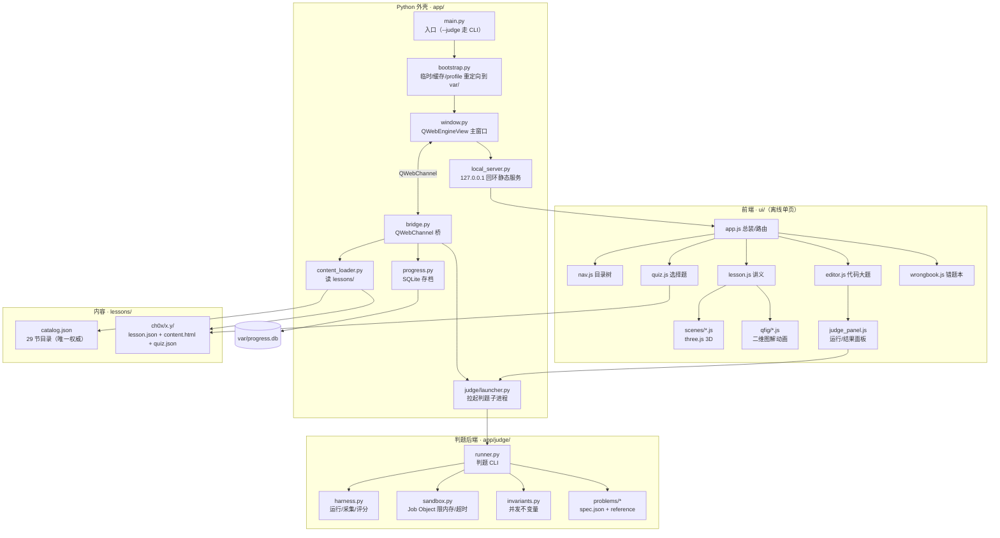
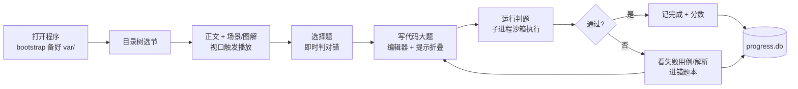

# OS_Train · 操作系统复习（王道第 1–2 章 · 29 节 · 离线桌面版）

一个**完全离线的 Windows 桌面复习程序**，覆盖《操作系统》内存管理之前的全部内容：
第 1 章「计算机系统概述」7 节 + 第 2 章「进程与线程」22 节，共 **29 节**。

每节 = 知识点正文 + 图形化讲解（3D 场景 / 二维图解动画）+ 选择题 + 可判题的写代码大题；
进度与错题落本地 SQLite，随开随续。

> **仓库只放源码。** 打包产物 `dist/`（约 512 MB）不入库，需要 exe 请按[打包](#打包构建-exe)一节自行构建。
> 程序不联网、不写 C 盘：缓存、临时文件、存档全部落在自身目录的 `var\`。

---

## 能做什么

| 模块 | 能力 |
| --- | --- |
| 课程浏览 | 左侧目录树按章/节导航，标签（概念 / 计算 / 高频 / 代码 / 动画 / 真题）着色区分 |
| 知识点正文 | 语义化 HTML，公式、表格、代码块、重点色块，深色主题 |
| 3D 场景 | 29 个 three.js 场景（内核态、进程状态机、调度对比、PV 原语、生产者-消费者、哲学家进餐、银行家、死锁检测…），滚入视口自动播 |
| 二维图解 | `ui/js/qfig/` 的 `.qf` 运行时：分步动画 + 静态图表混排，可手动步进、可随视口自动播 |
| 选择题 | 逐题作答、即时对错反馈、解析（解析本身也可挂图解） |
| 写代码大题 | CodeMirror 编辑器（Python 高亮）+ 一键运行判题，给出通过率与失败用例；支持「提示」折叠块与参考解析 |
| 存档 | 完成状态、得分、错题写入 `var\progress.db`，重启自动恢复 |
| 错题本 | 汇总做错的选择题与未通过的代码题，便于二轮 |

---

## 作用图

**① 整体架构：三层 + 一条回环**



**② 一次学习的闭环**



---

## 目录结构

```text
OS_Train/
├─ app/                      # Python 桌面外壳
│  ├─ main.py                # 入口：--judge 走判题 CLI，否则启动 GUI
│  ├─ bootstrap.py           # 路径解析 + TMP/缓存/profile 全指向 var/（零 C 盘写入）
│  ├─ window.py              # 主窗口（QWebEngineView + QWebChannel）
│  ├─ bridge.py              # JS <-> Python 方法桥
│  ├─ local_server.py        # 127.0.0.1 回环静态服务器（WebEngine 不能走 file://）
│  ├─ content_loader.py      # 读 catalog.json 与各节内容
│  ├─ progress.py            # SQLite 存档（var/progress.db）
│  ├─ splash.py              # 启动画面
│  └─ judge/                 # 判题后端
│     ├─ runner.py           # 判题 CLI（--judge --problem … --solution …）
│     ├─ harness.py          # 运行、采集、评分
│     ├─ invariants.py       # 并发题的不变量检查
│     ├─ sandbox.py          # Windows Job Object（内存/超时/句柄限制）
│     ├─ launcher.py         # GUI 侧拉起判题子进程
│     └─ problems/           # 14 个可判题题目（spec.json + reference.py）
├─ ui/                       # 前端（全离线，无 CDN）
│  ├─ index.html             # 单页应用入口
│  ├─ css/                   # theme.css（深色主题/图解样式）、codemirror-theme.css
│  ├─ js/
│  │  ├─ app.js              # 总装与路由
│  │  ├─ nav.js lesson.js quiz.js editor.js judge_panel.js wrongbook.js home.js
│  │  ├─ scenes/             # 29 个 three.js 3D 场景 + index/runtime
│  │  └─ qfig/               # 二维图解动画（dl-241 / dl-242 / dl-prevent）
│  └─ vendor/                # CodeMirror 5、three.js r169、qwebchannel.js
├─ lessons/                  # 课程内容
│  ├─ catalog.json           # 29 节目录（唯一权威来源）
│  ├─ ch01/                  # 1.1 – 1.7（7 节）
│  └─ ch02/                  # 2.1.1 – 2.4.5（22 节）
│                            # 每节：lesson.json + content.html + quiz.json
├─ assets/fonts/             # JetBrains Mono（16 个 woff2，离线字体）
├─ build/                    # 打包
│  ├─ os_train.spec          # PyInstaller 规格（onedir + 扁平布局）
│  ├─ build.ps1              # 一键构建（原地覆盖，不产生第二版本）
│  └─ _shim/                 # 构建期 DLL 预加载 shim（不进产物）
├─ tools/                    # setup_env.ps1 / fetch_vendor.ps1
├─ modify.md                 # 唯一的修改记录（倒序，新条目在最上方）
├─ 重要问题修复.md           # 重要缺陷归档（现象/根因/改法/时间）
├─ push_to_github.ps1        # 一键推送本仓库
└─ README.md
```

> 运行期生成、不入库：`dist/`（打包产物）、`var/`（存档与缓存）、`.venv/`、`.cache/`、`.vendor_src/`、`build/_work/`。

---

## 课程与题量

| 项 | 数量 | 位置 |
| --- | --- | --- |
| 章节 | 2 章 / 29 节 | `lessons/catalog.json` |
| 每节内容 | `lesson.json` + `content.html` + `quiz.json` | `lessons/ch0x/x.y/` |
| 3D 场景 | 29 个 | `ui/js/scenes/` |
| 二维图解模块 | 3 个（死锁 2.4.1 / 2.4.2 / 死锁预防专题） | `ui/js/qfig/` |
| 可判题题目 | 14 个 | `app/judge/problems/` |

判题题目一览：

`banker-algorithm` · `critical-section-flag` · `deadlock-detection` · `dining-philosophers` · `monitor-bounded-buffer` ·
`ordered-alloc` · `pc-bounded-buffer` · `proc-state-machine` · `process-control` · `rw-reader-writer` ·
`sched-algorithms` · `sched-metrics` · `sem-sync-mutex` · `semaphore-basic`

---

## 快速开始

### 从源码运行（仓库内的唯一方式）

```powershell
# 1) 建虚拟环境（会在项目内建 .venv，并把 pip 缓存也指到项目内）
powershell -ExecutionPolicy Bypass -File tools\setup_env.ps1

# 2) 启动
.venv\Scripts\python.exe app\main.py
```

依赖：Python 3.13 + PySide6（含 QtWebEngine）。离线前端依赖由 `tools\fetch_vendor.ps1` 拉取到 `ui\vendor\`。

### 打包后运行

构建完成后双击 `dist\OS_Train\OS_Train.exe`（或项目根目录的 `OS_Train.lnk`）。

> `OS_Train.exe` 是 PyInstaller **onedir** 布局，必须与同目录的 `PySide6\ ui\ lessons\ assets\` 一起存在，
> **不能单独复制 exe**。

---

## 打包（构建 exe）

```powershell
powershell -ExecutionPolicy Bypass -File build\build.ps1
```

脚本行为（遵循「零 C 盘写入 / 只保留一份版本」）：

1. `TMP/TEMP/TMPDIR` → `build\_tmp`，`PYINSTALLER_CONFIG_DIR` → `build\_pyi_cache`（都在项目内）；
2. **先清理残留进程**（`OS_Train` / `QtWebEngineProcess`），避免占用导致覆盖失败；
3. 删除旧 `dist\` 与 `build\_work\`（原地覆盖，不保留旧版本副本）；
4. 运行 PyInstaller（`build\os_train.spec`，onedir + `contents_directory="."`）；
5. 校验关键产物（`OS_Train.exe`、`QtWebEngineProcess.exe`、`en-US.pak`、`lessons/`、`ui/`、`assets/`、判题题目），失败返回码 2。

产物：`dist\OS_Train\OS_Train.exe`（目录总大小约 512 MB）。

### 关键设计

- **onedir + `contents_directory="."`**：冻结后 `app_root() == resource_root() == exe 目录`，与开发期相对路径完全一致。
- **`console=False`**：GUI 无黑框；判题子进程复用同一 exe，stdout 由父进程管道传入，`runner.py::_ensure_std_streams()` 重新绑定句柄。
- **`build\_shim` 的 sitecustomize**：修复 PyInstaller 隔离子进程因 PATH 上同名 Qt6 DLL 而 `import QtCore` 失败、进而漏收 QtWebEngine 资源；仅构建期使用。
- **ICU DLL 裁剪**：产物不带任何 `icu*.dll`（PATH 上 Anaconda 的 ICU 73 会被误收，而 PySide6 依赖 ICU 72）。

---

## 判题命令行

冻结后的 exe 同时是判题引擎，可脱离 GUI 调用：

```powershell
dist\OS_Train\OS_Train.exe --judge `
  --problem dist\OS_Train\app\judge\problems\pc-bounded-buffer\spec.json `
  --solution path\to\your_solution.py
```

输出逐行 JSON：`start` / `run_start` / `run_result` / `done`（`verdict`、`score`、`summary`、`passed_runs`、`total_runs`）。
退出码：0 通过、2 未通过、3 用法或加载错误。

题目两类：

- `kind = deterministic`：给定输入 → 期望输出（`exact` / `numeric`）逐用例比对；
- `kind = concurrency`：多次运行检查并发不变量（无死锁、无丢失更新、临界区不重叠等）。

---

## 零 C 盘写入

- 目标平台：Windows 10/11 x64。
- 所有可写状态都在程序目录下的 `var\`：`progress.db`（存档）、`tmp\`（临时）、`webengine\`（Chromium 缓存/Profile）、`log\`（启动日志）。
- `app\bootstrap.py` 在启动即把 `TMP/TEMP/TMPDIR`、Chromium 的 `--disk-cache-dir` / `--user-data-dir`、
  `QWebEngineProfile` 的缓存与存储路径、Qt 着色器磁盘缓存全部改到 `var\`（或禁用）。
- 说明（最佳努力）：显卡驱动（NVIDIA 等）可能自行写 `C:\ProgramData\...` 的 GPU 缓存，属驱动行为。

---

## 变更记录

- 所有改动（含根因、验证证据、回滚方法）统一记录在 [modify.md](modify.md)，**新条目在最上方、序号递增**。
- 重要缺陷的「现象 / 根因 / 改法 / 时间」另见 [重要问题修复.md](重要问题修复.md)。
